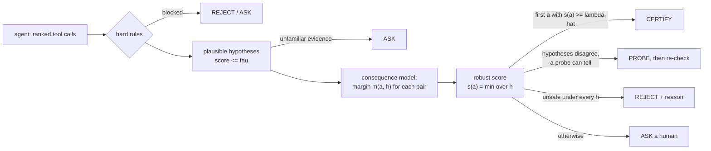

# riskgate

**Certify, reject, probe or ask: calibrated, consequence-aware checks for the actions of LLM agents.**

`riskgate` sits between an AI agent and its tools. Before a consequential action runs (scaling a service, issuing
a refund, changing a reactor setpoint) it predicts what the action would do under **every explanation of the
current situation that the evidence cannot rule out**. It lets the action through only if the worst plausible
outcome clears a safety threshold that has been **calibrated on labelled outcomes**, so that unsafe actions get
through at most a chosen fraction α of the time, *whatever the quality of your simulator*.

```text
agent proposes ──► riskgate ──► CERTIFY  → the tool runs
                     │     ├──► REJECT   → "unsafe under every explanation; binding constraint: p95 latency" → agent re-plans
                     │     ├──► PROBE    → "first run pg_stat_statements: it tells the two likely causes apart"
                     │     └──► ASK      → a human decides, with the gate's explanation
                     └── no LLM on this path · fail-closed · every decision is logged and fingerprinted
```

> **Status: 1.0.0rc3 (release candidate), Apache-2.0.** Everything below runs locally and is tested. The three example
> domains are **simulated** with scripted (LLM-like) agents. In addition, [`benchmarks/`](https://github.com/reallysaurabh/riskgate/tree/main/benchmarks/) replays **public
> logs of real LLM agents** offline: τ²-bench with eight 2026 frontier models, AgentDojo prompt-injection runs of 28
> model/defence pipelines, and ITBench. It also covers public telemetry and plant data (RCAEval, Tennessee Eastman).
> The calibrated bound held for all 40 agent configurations replayed; see [Results on real agents](https://github.com/reallysaurabh/riskgate#results-on-real-agents-public-benchmarks).
> The paper is under submission (see [Project status](https://github.com/reallysaurabh/riskgate#project-status)).

---

## In one minute (no jargon)

Imagine a new assistant on a night shift. Alarms go off, and the assistant wants to press a button.

- A **careless** assistant presses the button that fits its first guess.
- A **rule-following** assistant checks a list of forbidden buttons. The list knows nothing about tonight.
- A **careful** assistant asks: *"What could be going on? What would this button do in each case? Is it safe in all
  of them?"* If yes, it presses. If it is clearly a bad idea, it says why. If it cannot tell, it first does a
  harmless check (looks at a second gauge) or calls the supervisor.

`riskgate` is the careful assistant, built as software. And it keeps score: it has been tested on hundreds of past
or simulated situations, so it can say *"when I say 'safe', I am wrong at most 5% of the time"*, and it says
*"I don't know"* when a situation looks unlike anything it was tested on.

## What it is (for engineers)

| You provide | Example | riskgate does |
|---|---|---|
| a **consequence model** `predict(action, hypothesis, context)` | digital twin, queueing model, `--dry-run`, DB savepoint + rollback | evaluates every candidate under every plausible hypothesis |
| a **hypothesis provider** `hypotheses(context)` (scored) | fault diagnoser, incident classifier, intent parser | keeps the calibrated *plausible set* (true cause retained with prob. ≥ 1 − δ) |
| a **spec** of signed margins | `Upper("p95_ms", 800)`, `Envelope("T", 340, 362)`, STL formulas | robust score = worst margin over plausible hypotheses |
| **labelled episodes** | simulated incidents, sandbox replays, audited postmortems | conformal risk control picks the threshold λ̂ with E[unsafe certified] ≤ α |
| optional **hard rules**, **probes** | "refunds > $500 need approval", read-only diagnostics | rules run first; probes are chosen to resolve the disagreement between hypotheses |

Numpy is the only runtime dependency. The certify path never calls an LLM, and anything unexpected (exceptions,
timeouts, missing or stale calibration, a failing audit sink) produces `ASK`, never `CERTIFY`.

## Install

```bash
pip install --pre riskgate              # release candidate; extras: yaml, otel, mcp, langgraph, adk, openai-agents
pip install -e ".[dev]"                 # from a clone
```

Python ≥ 3.10. [PyPI](https://pypi.org/project/riskgate/) · [GitHub](https://github.com/reallysaurabh/riskgate) (a ⭐ helps others find it).

## Thirty-second example

```python
import riskgate as rg

class TankModel:                                   # consequence model: what would the action do?
    version = "tank-model-v1"                      # bump on every change: old calibrations become VOID
    def predict(self, action, hyp, ctx):
        return {"level": ctx["level"] + action.args["v"] - hyp.params["leak"]}

class LeakDiagnoser:                               # hypotheses: what could be going on? (lower score = better fit)
    version = "leak-diag-v1"
    def hypotheses(self, ctx):
        return [rg.Hypothesis(f"leak={l}", family=f"leak{l}", params={"leak": l},
                              score=abs(ctx["flow"] - l) / 8) for l in (0, 15, 30)]

gate = rg.Gate(TankModel(), rg.Spec(rg.Envelope("level", lo=10, hi=100, scale=10)), LeakDiagnoser(), alpha=0.05,
               doer_id="tank-agent:v1")            # the agent whose proposals you calibrate on: swapping it voids the calibration
gate.calibrate(labelled_episodes)                  # sets tau and lambda-hat; status -> VALID

d = gate.check(rg.Action("add", {"v": 40}), {"level": 80, "flow": 15.0})
print(d.verdict, d.reason)                         # ASK: cannot certify: best robust margin -2.000 < threshold -1.763 ...

@rg.guard(gate, context=read_tank_state)           # or guard any tool function your agent framework calls
def add(v: float) -> str: ...
```

The complete, runnable version (with episode generation) is [`examples/quickstart.py`](https://github.com/reallysaurabh/riskgate/blob/main/examples/quickstart.py).
The production-like lifecycle (calibrate → sign → deploy → outcomes → drift → recalibrate) is
[`examples/end_to_end_sre.py`](https://github.com/reallysaurabh/riskgate/blob/main/examples/end_to_end_sre.py), explained step by step in
[docs/end_to_end.md](https://github.com/reallysaurabh/riskgate/blob/main/docs/end_to_end.md).

## How a decision is made



Every decision carries a **guarantee status**: `VALID` (calibrated, components unchanged, no drift), `DEGRADED`
(the drift monitor fired: the threshold may only tighten until you recalibrate) or `VOID` (no calibration, or the
model, spec, rules, probes or agent changed since calibration: every check returns `ASK`).

## What is guaranteed, and what is not

For exchangeable episodes and unchanged components:

| Mode | Guarantee |
|---|---|
| `policy` (default) | P(the action your agent executes is unsafe) ≤ α, for the agent you calibrated with (`doer_id` is fingerprinted) |
| `agnostic` | the same bound for **any** agent that executes only certified actions, even after you swap the LLM |
| `guarantee="high_probability"` | P(risk of *this* calibrated gate ≤ α) ≥ 1 − δ (Learn-then-Test), instead of on average |
| two-stage probing | probe harm + unsafe execution after the probe, in total ≤ α |

Not guaranteed: per-situation (conditional) risk; validity under arbitrary distribution shift (the drift monitor
detects it, the threshold only tightens, and you recalibrate); multi-step closed-loop behaviour; wrong labels.
A bad consequence model costs **efficiency** (more `ASK`s), not validity. Details:
[docs/calibration.md](https://github.com/reallysaurabh/riskgate/blob/main/docs/calibration.md).

## Use cases

Building blocks for the decisions on the [RiskGate site](https://github.com/reallysaurabh/riskgate/blob/main/docs/use_cases.md), each with a runnable, simulated example in
[`examples/use_cases/`](https://github.com/reallysaurabh/riskgate/tree/main/examples/use_cases/):

| Module | For | Example |
|---|---|---|
| `rg.DiscreteWorlds`, `rg.OutcomeTable` | one hidden fact with a few values: paid or failed, already refunded, a hold or fraud, dormant or scheduled | `payments_upi.py`, `missing_item_refund.py`, `card_dispute.py`, `idle_vm_cleanup.py` |
| `riskgate.provenance` | instructions planted in files, e-mails and web pages (prompt injection) | `prompt_injection.py` |
| `rg.replay`, `rg.resplit`, `rg.sweep` | run labelled history through a gate; validity over re-splits; the error budget as a dial | all of them |
| `riskgate.rules` | `needs_person`, `never`, `amount_above`, `irreversible` | `card_dispute.py`, `payments_upi.py` |

```python
table = rg.OutcomeTable({"confirm_order": ["paid_late"], "reply_auto_reversal": ["failed"], "issue_refund": ["paid_twice"]},
                        reveals={"check_txn_status": {"paid_late": "SUCCESS", "failed": "FAILED", "pending": "PENDING",
                                                      "paid_twice": "DUPLICATE"}})
gate = rg.Gate(table, table.spec, worlds, probes=table.probes(), noop=table.noop, min_separation=table.separation / 2,
               doer_id="support-bot:v1")
gate.calibrate(history)
print(rg.replay(gate, held_out))    # unsafe 1.5% (agent alone 88.8%) · autonomous 79.8% · asked 20.2% · probed first 72.7%
```

## Works with your agent framework

| Framework | Adapter | `ASK` becomes | Tested with |
|---|---|---|---|
| any Python tool | `@rg.guard(gate, context=...)` | `on_ask` hook or `ApprovalRequired` | — |
| LangGraph | `langgraph_gate_node`, `gated_tool_node` | `interrupt()` → `Command(resume=...)` | langgraph 1.2.12 |
| Google ADK | `adk_before_tool_callback`, `adk_plugin` | ADK tool confirmation | google-adk 2.11.0 |
| OpenAI Agents SDK | `guarded_function_tool`, `riskgate_tool_input_guardrail`, `riskgate_needs_approval` | SDK approval interruptions | openai-agents 0.23.1 |
| any MCP client | `riskgate serve-mcp ... -- <upstream server>` | `isError` result with the gate's feedback | mcp 2.3.0 |

Each adapter has offline contract tests (fake models, no network). See [docs/integrations.md](https://github.com/reallysaurabh/riskgate/blob/main/docs/integrations.md)
and [examples/integrations/](https://github.com/reallysaurabh/riskgate/tree/main/examples/integrations/).

## Command line

```bash
riskgate calibrate --gate mypkg.gates:make_gate --episodes mypkg.data:load --out gate.cal.json --key "$RISKGATE_KEY"
riskgate report gate.cal.json --key "$RISKGATE_KEY"        # thresholds, plausible-set size, probing, fingerprint
riskgate validate gate.cal.json --gate mypkg.gates:make_gate  # exit 3 if the artefact no longer matches the code
riskgate audit-summary decisions.jsonl                       # verdict counts, statuses, latency percentiles
riskgate serve-mcp --gate mypkg.gates:make_gate --calibration gate.cal.json -- python upstream_server.py
```

## Results on three simulated domains

All numbers are from **simulated** domains with scripted (LLM-like) agents, α = 5%. "riskgate" columns are means
over random re-splits of calibration and test data, which is what conformal risk control bounds. Full tables,
ablations and caveats: [docs/results.md](https://github.com/reallysaurabh/riskgate/blob/main/docs/results.md).

| Domain (consequence model) | agent's first choice unsafe | binary twin gate: unsafe | **riskgate: unsafe** | riskgate: asks a human | single-diagnosis CRC: asks |
|---|---|---|---|---|---|
| Chemical reactor (first-principles twin) | 36.2% | 16.2% | **4.6%** | 33.6% | 90.7% |
| Kubernetes incident (queueing twin) | 36.2% | 6.9% | **4.0%** | 22.7% | 19.3% |
| Refunds (SQLite dry-run) | 40.6% | 8.1% | **1.6%** | 25.7% | 100% |

- Calibrating around the single most likely diagnosis is valid but useless where misdiagnoses matter (it asks about
  almost everything); in the Kubernetes domain it is competitive, and we say so.
- Probing (e.g. "read the backup thermocouple first") cuts the ask rate by 14–29% (relative, fixed split) while keeping the total risk ≤ α.
- **Honest caveat:** on one fixed split the reactor's unsafe rate was 9.2%. An expectation guarantee allows such
  splits; a cliff in that domain's risk curve makes them more likely. `guarantee="high_probability"` (6.2% on that
  split, no re-split above α in any domain) is the fix when you need the bound for your own artefact.


## Results on real agents (public benchmarks)

[`benchmarks/`](https://github.com/reallysaurabh/riskgate/tree/main/benchmarks/) evaluates the same library offline on logs published with public benchmarks.
- No LLM is called; the gate is LLM-free by design.
- Tasks are the exchangeable units (`calibrate(groups=...)`).
- Every number is a mean over 200 random task re-splits.
- Protocol: [benchmarks/README.md](https://github.com/reallysaurabh/riskgate/blob/main/benchmarks/README.md). Details: [docs/results_real_agents.md](https://github.com/reallysaurabh/riskgate/blob/main/docs/results_real_agents.md).

| Benchmark | Real data | Headline |
|---|---|---|
| τ²-bench retail, 2026 leaderboard | 4,855 database writes by 8 frontier agents | wrong writes 5.0–9.6%; with RiskGate at α = 10%, unsafe 7.3–8.9% for every agent; asks on 6–28% of writes (53–70% at α = 5%) |
| τ²-bench airline, 2026 leaderboard | 1,370 writes by the same agents | wrong writes 8.9–26.5%; with RiskGate at α = 10%, unsafe 4.6–5.9%; asks on 35–80% (α = 5% is infeasible with 50 tasks) |
| ITBench SRE | 85 root-cause claims by a GPT-OSS-120B agent | claims right in 17.6%; evidence gate AUROC 0.90; too few scenarios for α ≤ 10% |
| RCAEval | real fault-injection telemetry | true root cause in the conformal plausible set 96.2% of the time at δ = 5% (mean size 4.2 of 55) |
| AgentDojo prompt injection | 20,833 state-changing calls by 28 model/defence pipelines (benign + `important_instructions` runs) | at α = 5%, re-split unsafe 0.2–3.1% across all 27 held-out pipelines (median 2.0%, vs median base 29.3%); median attack success 12.3% → 1.5% with 100% (median) of benign runs needing no human |
| Refund Arena (Sep 2026) | 200 synthetic tickets, 80 boundary-pair orders | SQLite dry-run reproduces all 445 gold labels under the true intent; policy check is already exact on held-out tickets |
| Tennessee Eastman (Rieth 2017) | 500 runs per fault (81,900 held-out windows) | top-1 80.0%; conformal fault set covers 95.0% at δ = 5% (mean size 2.1), widening to 4.7 classes on the undetectable IDV 3/9/15 |

What the real logs show:
- **The bound held for every agent** (12 τ²-bench agents, 28 AgentDojo pipelines).
- **Efficiency depends on the hypothesis provider.** Lexical readings barely separate frontier agents' remaining errors
  (AUROC 0.49–0.65). Readings from other agents' runs reach 0.92–0.96, but that is an optimistic upper bound.
- **Confirmation is not verification.** 355 of 363 wrong retail writes came right after an explicit "yes".
- **Calibrated beats blunt.** Against prompt injection, a rule that blocks every call with an untrusted address stops
  attacks about as well (median 1.6% vs 1.5%) but lets only 68% of benign runs through without a human (RiskGate: 100%).
- **Recalibrate when the agent changes.** A calibration fitted to 2025 agents gave 14.6% unsafe on the 2026 agents in
  airline at α = 10%; swapping AgentDojo pipelines exceeded α in 35% of pairs. Set `doer_id` so a swap voids the
  calibration (policy mode warns if it is missing).
- **Count tasks, not tool calls.** With grouped calibration the risk-control split needs at least ⌈1/α⌉ independent
  tasks (20 at α = 5%, about 29 in total with the default 30% τ split), and the high-probability guarantee at α = 5%,
  δ' = 0.1 needs about 45 loss-free tasks before it certifies anything.

## Documentation

| Page | For |
|---|---|
| [Concepts](https://github.com/reallysaurabh/riskgate/blob/main/docs/concepts.md) | the picture, the verdicts, the components |
| [Quickstart](https://github.com/reallysaurabh/riskgate/blob/main/docs/quickstart.md) | the tank example, step by step |
| [End-to-end tutorial](https://github.com/reallysaurabh/riskgate/blob/main/docs/end_to_end.md) | an SRE agent's full lifecycle, with real output |
| [Bring your own domain](https://github.com/reallysaurabh/riskgate/blob/main/docs/byo_domain.md) | templates for your simulator, diagnoser and spec |
| [Use cases](https://github.com/reallysaurabh/riskgate/blob/main/docs/use_cases.md) | the sixteen stories of the RiskGate site, mapped to building blocks and scripts |
| [Calibration & guarantees](https://github.com/reallysaurabh/riskgate/blob/main/docs/calibration.md) | exactly what is promised, and how |
| [Operations](https://github.com/reallysaurabh/riskgate/blob/main/docs/operations.md) | artefacts, signing, monitoring, recalibration, audit, OpenTelemetry |
| [Integrations](https://github.com/reallysaurabh/riskgate/blob/main/docs/integrations.md) | LangGraph, ADK, OpenAI Agents SDK, MCP |
| [CLI](https://github.com/reallysaurabh/riskgate/blob/main/docs/cli.md) · [Configuration](https://github.com/reallysaurabh/riskgate/blob/main/docs/configuration.md) · [API reference](https://github.com/reallysaurabh/riskgate/blob/main/docs/api.md) | reference |
| [Results](https://github.com/reallysaurabh/riskgate/blob/main/docs/results.md) | all tables, ablations, honest caveats |
| [Results on real agents](https://github.com/reallysaurabh/riskgate/blob/main/docs/results_real_agents.md) | offline replays of public benchmark logs (τ²-bench, AgentDojo, ITBench, RCAEval, Refund Arena, TEP) |
| [FAQ](https://github.com/reallysaurabh/riskgate/blob/main/docs/faq.md) | common questions |
| [Specification](https://github.com/reallysaurabh/riskgate/blob/main/docs/SPEC.md) | design |

The accompanying paper is under submission; a link will be added here once it is public.

## Project status

Release candidate `1.0.0rc3`. Implemented and tested (100+ tests including statistical validity tests,
fuzzed fail-closed tests and framework contract tests): the core gate, both guarantee modes, high-probability and
multi-risk calibration, weighted CRC, grouped calibration for dependent decisions, STL specifications, two-stage
probing, drift monitoring with tighten-only adaptation, delayed outcomes and recalibration, signed artefacts, audit and
OpenTelemetry sinks, configuration files, the CLI, four framework adapters, three example domains with released
calibration data, and offline evaluations on public real-agent logs ([`benchmarks/`](https://github.com/reallysaurabh/riskgate/tree/main/benchmarks/)).

Not done yet:
- online evaluations with live LLM agents and real users (the `riskgate.doers.LLMRanker` adapter is ready); the
  real-agent results so far are offline replays of published logs;
- the paper is under submission (no public link yet).

## Responsible use

riskgate is a research-grade **supervisory** layer. It does not replace certified safety systems (safety
instrumented systems, interlocks), access control or human oversight, and its guarantee is statistical, not a
proof. Treat `VOID` and `DEGRADED` seriously, and keep catastrophic or irreversible actions behind hard rules.

## Citation

```bibtex
@misc{gupta2026riskgate,
  title  = {RiskGate: Certify, Reject or Ask. Hypothesis-Robust, Distribution-Free Risk Control
            for the Actions of LLM Agents},
  author = {Gupta, Saurabh},
  year   = {2026},
  note   = {Under submission; software: riskgate 1.0.0rc3}
}
```

## License

[Apache-2.0](https://github.com/reallysaurabh/riskgate/blob/main/LICENSE).
