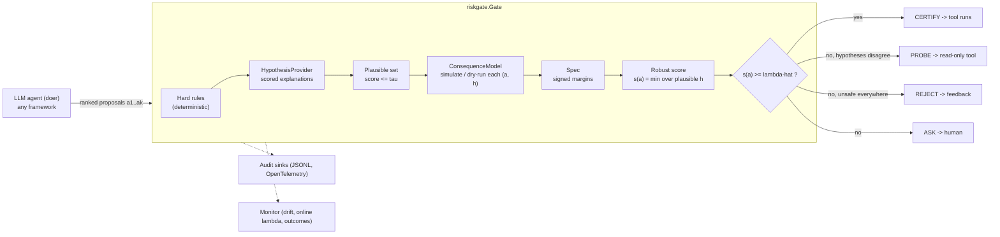

# riskgate — Framework & Codebase Specification

*Version 1.0.0rc1 · 11 October 2026 · Author: Saurabh Gupta*
*Status legend:* ✅ implemented and tested in 1.0.0rc1 · 🛠 planned · 🔬 research question

---

## 1. Purpose

`riskgate` is a Python library that sits **between an LLM agent and the tools that change the world** and answers, for every proposed action, one of four verdicts:

| Verdict | Meaning | What the agent / framework does |
|---|---|---|
| **CERTIFY** | The action is covered by a calibrated risk bound | The tool executes |
| **REJECT** | Unsafe under *every* plausible explanation of the current state, or blocked by a hard rule | The agent gets structured feedback and re-plans |
| **PROBE** | Plausible explanations disagree; a read-only action can tell them apart | Run the probe, update context, re-check (stage 2) |
| **ASK** | The gate cannot certify (ambiguous, out-of-distribution, uncalibrated, error, timeout) | Escalate to a human / safe fallback |

The core guarantee (Section 6): with episodes exchangeable between calibration and deployment,

$$\Pr(\text{an executed, certified action is unsafe}) \le \alpha,$$

for an operator-chosen $\alpha$, **regardless of how good the consequence model is**. A poor model produces more ASK, not more unsafe certifications.

### 1.1 Non-goals

- Not a content-moderation or prompt-injection filter (compose with Llama Guard, LlamaFirewall or NeMo Guardrails for that).
- Not a replacement for hard safety layers (safety instrumented systems, interlocks, IAM). riskgate is an *additional* supervisory layer.
- Not a formal verifier. Guarantees are statistical and marginal over episodes.

### 1.2 Who it is for

Teams whose agents take **consequential actions in environments that can be simulated, dry-run or replayed**:
- process plants and energy systems (digital twins);
- infrastructure operations (`kubectl --dry-run`, `terraform plan`, capacity models);
- transactional software (dry-runs on database clones, payment sandboxes);
- robotics (physics simulators);
- finance (backtests).

---

## 2. Design principles (normative)

| ID | Principle | Consequence in code |
|---|---|---|
| **R1** | **Independence.** The certify path never calls an LLM. LLM-derived inputs may only make the gate *more* conservative. | LLMs may propose hypotheses (which can only lower the min-margin) or hard rules. Online adaptation can only tighten λ (`max(λ̂, λ_online)`). ✅ |
| **R2** | **Validity by calibration, not by model quality.** | The guarantee comes from conformal risk control (CRC) on realised outcomes. Calibration evaluates episodes with exactly the deployed decision path. Score design affects efficiency only. ✅ |
| **R3** | **Fail closed.** | Any exception, timeout, missing context, failing audit sink, missing or stale calibration, or out-of-distribution evidence → ASK, never CERTIFY. ✅ |
| **R4** | **Humility.** The gate knows when its guarantee does not apply. | `GuaranteeStatus ∈ {VALID, DEGRADED, VOID}` is attached to every decision. ✅ |
| **R5** | **Thin, framework-agnostic adapters.** | Core has no framework imports. Adapters import frameworks lazily and are covered by contract tests. ✅ |
| **R6** | **Auditability.** | Every decision is a serialisable record with a `decision_id`. Calibration artefacts carry component fingerprints and optional HMAC signatures. ✅ |
| **R7** | **Minimal dependencies.** | Core needs only `numpy`; everything else is an extra. ✅ |

---

## 3. Concepts



| Term | Definition |
|---|---|
| **Action** | A proposed tool call: `name`, `args`, `read_only`. `read_only=True` marks probes. |
| **Context** | Whatever the domain needs to evaluate actions (state snapshot, observation window, ticket, DB handle). Opaque to the core. |
| **Hypothesis** | One explanation of the partially observed state: a fault, a user intent, a load regime. Carries a **nonconformity score** (lower = fits the evidence better) and a **family** label used during calibration. |
| **Plausible set** | Hypotheses with `score <= tau`. τ is a conformal quantile, so the true family is kept with probability ≥ 1 − δ. |
| **Consequence model** | Predicts the outcome of an action under a hypothesis: a digital twin, simulator, transactional dry-run, surrogate or learned world model. |
| **Spec** | A conjunction of constraints that turns an outcome into a **signed margin**: positive is safe, negative is violated, and the magnitude is in normalised units. |
| **Robust score** | `s(a) = min over plausible h of margin(a, h)` (or a custom `score_fn`). |
| **Episode** | One labelled decision point used for calibration: context, ranked candidates, and ground-truth `unsafe` labels. Optionally includes post-probe episodes. |
| **Calibration** | The artefact with τ, τ_ood, λ̂ (and λ₁, λ₂ for probing), the guarantee type, the fingerprint, curves and diagnostics. |

---

## 4. Package layout (1.0.0rc1)

```
riskgate/
  __init__.py          public API, __version__                                                      ✅
  types.py             Action, Hypothesis, Decision, Verdict, GuaranteeStatus, canonical/digest,
                       callable_digest (content hashes of user functions)                           ✅
  spec.py              Constraint, Upper, Lower, Envelope, Predicate, Custom, Spec, HardRule        ✅
  stl.py               Signal temporal logic: Pred, Not, And, Or, Implies, Always, Eventually,
                       Until, STLConstraint (quantitative robustness)                               ✅
  conformal.py         conformal_quantile, lambda_grid, agnostic/policy losses, crc_threshold        ✅
  multirisk.py         Learn-then-Test: binomial / Hoeffding / Hoeffding-Bentkus p-values,
                       ltt_pvalues, ltt_threshold (several risks, fixed-sequence testing)          ✅
  weighted.py          weighted_conformal_quantile, weighted_crc_threshold, WeightedCRC             ✅
  gate.py              Gate, Episode, Calibration (signed artefacts), protocols, SingleHypothesis,
                       CallableModel, SignatureError                                                ✅
  monitor.py           Monitor: conformal test martingale (latched alarm), online ACI lambda,
                       delayed outcomes by decision id                                              ✅
  audit.py             AuditLog (JSONL, redaction), MemoryAudit, MultiSink, summarize_audit          ✅
  telemetry.py         OTelSink: OpenTelemetry spans and metrics                                     ✅
  config.py            JSON / TOML / YAML configuration, declarative hard rules (no eval)           ✅
  cli.py               riskgate version | report | validate | calibrate | audit-summary | serve-mcp ✅
  doers.py             LLMRanker: real-LLM doer for any OpenAI-compatible endpoint (stdlib only)    ✅
  adapters/
    tool.py            guard() decorator (sync/async) for any framework                             ✅
    frameworks.py      Google ADK callback + plugin; LangGraph gate node, router, ToolNode wrappers ✅
    openai_agents.py   guarded_function_tool, tool input guardrail, needs_approval                  ✅
    mcp_proxy.py       MCP proxy server gating every tool of an upstream server (stdio)             ✅
examples/
  quickstart.py        tank toy, five steps                                                          ✅
  end_to_end_sre.py    full lifecycle: calibrate, sign, deploy, outcomes, drift, recalibrate         ✅
  harness.py           six-policy comparison, Wilson CIs, re-split validity, alpha sweep, export     ✅
  ablations.py         mode, doer swap, delta, n, guarantee type, probe share, latency               ✅
  cstr_reactor.py      process plant (vendored twin from certify-reject-ask)                         ✅
  k8s_incident.py      SRE agent on a Kubernetes service + Postgres (queueing simulator)             ✅
  refunds_agent.py     support agent with a SQLite transactional dry-run                              ✅
  integrations/        offline LangGraph, ADK, OpenAI Agents SDK and MCP examples                     ✅
tests/                 core, features and regressions, STL, LTT, weighted; contract/ (frameworks)    ✅
```

---

## 5. Public API

### 5.1 Types (`riskgate.types`) ✅

```python
class Verdict(str, Enum):        CERTIFY, REJECT, ASK, PROBE
class GuaranteeStatus(str, Enum): VALID, DEGRADED, VOID

@dataclass(frozen=True)
class Action:
    name: str
    args: Mapping[str, Any] = {}
    read_only: bool = False
    key: str                          # canonical "name({json args})", used for labels and caching

@dataclass(frozen=True)
class Hypothesis:
    name: str
    family: str | None = None         # calibration label; defaults to name
    params: Mapping[str, Any] = {}
    score: float = 0.0                # nonconformity: lower = more plausible

@dataclass
class Decision:
    verdict: Verdict; action: Action | None
    score: float; threshold: float                 # robust margin of `action` and the lambda used
    margins: dict[str, float]; binding: dict[str, str]  # per plausible hypothesis
    plausible: list[str]; probe: Action | None; reason: str
    status: GuaranteeStatus; calibration_id: str | None
    considered: list[dict]; stage: int; latency_ms: float
    decision_id: str                               # for delayed outcomes and audit joins
    top_score: float                               # best robust score at this decision (drift statistic)
    approved: bool (property); to_dict() -> dict

callable_digest(fn) -> str    # content hash: source (or bytecode) + defaults + simple closure values,
                              # or fn.riskgate_version if set
```

### 5.2 Specs (`riskgate.spec`, `riskgate.stl`) ✅

```python
Upper(key, limit, scale=1.0)          # (limit - max(x)) / scale
Lower(key, limit, scale=1.0)          # (min(x) - limit) / scale
Envelope(key, lo, hi, scale=1.0)      # min(hi - max(x), min(x) - lo) / scale   (x scalar or trajectory)
Predicate(name, fn, safe_margin=1, unsafe_margin=-1)
Custom(name, fn)                      # any signed margin
Spec(*constraints, floor=None)        # margin = min over constraints; NaN -> -inf (R3)
HardRule(name, fires(action, ctx) -> bool, verdict=REJECT|ASK, message="", version=None)

# signal temporal logic (Donzé & Maler 2010), integer step windows, b=None means "to the end"
STLConstraint("T in band, settles", Always(And(Pred("T", "<=", 362), Pred("T", ">=", 340)), 0, None))
Pred(key, ">=" | "<=", threshold, scale=1.0); Not; And; Or; Implies; Always(phi, a, b); Eventually(phi, a, b)
Until(phi, psi, a, b, strict=False)   # every formula: rho(signals) -> trace, robustness(signals, t=0)
```

**Normalisation rule.** Every constraint must express its margin in comparable units (via `scale`), because the Spec takes the minimum across constraints. Example: `Upper("p95_ms", 800, scale=800)` with `Upper("error_rate", 0.02, scale=0.02)`.

**STL conventions.** Windows are truncated at the end of the signal; an empty window gives +∞ for `Always` and −∞ for `Eventually`/`Until`, so `Always(φ) == Not(Eventually(Not(φ)))` holds exactly. `Always(And(Pred('T','<=',362), Pred('T','>=',340)), 0, None)` equals `Envelope('T', 340, 362)` exactly. Infinite margins are clipped by the gate (Section 5.4.1).

### 5.3 Component protocols (`riskgate.gate`) ✅

```python
class ConsequenceModel(Protocol):
    version: str                                                  # part of the fingerprint
    def predict(self, action, hypothesis, context) -> Outcome: ...
    # optional, strongly recommended:
    def predict_batch(self, actions, hypotheses, context) -> list[list[Outcome]]: ...

class HypothesisProvider(Protocol):
    version: str
    def hypotheses(self, context) -> list[Hypothesis]: ...         # scored

SingleHypothesis(name="nominal")      # domains without latent ambiguity
CallableModel(fn, version, batch_fn=None)
```

**Outcome contract.** Any mapping or object that the Spec's constraints can read. **Probes** must also return `observation`: a vector in *noise units* (e.g. `log(value)/relative_noise`), so that distances between hypotheses are comparable to measurement noise.

### 5.4 The Gate ✅

```python
gate = Gate(consequence, spec, hypotheses=None, *,
            alpha=0.05, mode="policy" | "agnostic", delta=0.05,
            hard_rules=(), probes=(), noop=None, noop_tol=0.0, min_separation=1.0, min_resolved=0.3,
            ood_alpha=0.01, audit=None, monitor=None, require_calibration=True,
            doer_id=None,            # fingerprinted in policy mode
            timeout_s=None,          # wall-clock budget per check -> ASK on timeout
            cache_size=0, context_key=None,   # LRU margin cache; context_key REQUIRED when cache_size > 0
            parallel=0,              # threads for models without predict_batch
            weight_fn=None,          # context -> likelihood ratio (weighted CRC)
            score_fn=None)           # custom aggregation of a candidate's margins (default: min)

gate.calibrate(episodes, *, alpha=None, mode=None, delta=None, probe_share=0.6, probe_split=0.5,
               tau_fraction=0.3, seed=0, guarantee="expectation" | "high_probability", delta_ltt=0.1,
               extra_losses=None, weights=None) -> Calibration
gate.check(action, context, stage=1) -> Decision
gate.check_ranked(candidates, context, stage=1) -> Decision
gate.record_outcome(decision | decision_id, unsafe) -> bool       # delayed labels
gate.recalibrate(episodes, **kw) -> Calibration                   # calibrate + reset the monitor
gate.select_probe(actions, plausible, margins, context, lam) -> (Action | None, resolved share)
gate.margin_matrix(actions, hyps, context) -> (ndarray[n_actions, n_hyps], binding names)
gate.fingerprint() -> str; gate.status() -> GuaranteeStatus
gate.load_calibration(Calibration | path, key=None, require_signature=False)
```

`calibrate(mode=...)` sets `gate.mode`; `load_calibration` sets `gate.mode` to the artefact's mode, so the fingerprint always reflects the mode actually calibrated.

#### 5.4.1 Decision algorithm (`check_ranked`)

```
status <- VOID if no calibration or fingerprint mismatch; DEGRADED if monitor alarm; else VALID
if status == VOID and require_calibration: return ASK("guarantee void")
for a in candidates (doer rank order):                         # hard rules first (Gate._screen)
    if a REJECT-rule fires: record, skip
    if an ASK-rule fires: if a is the first viable -> return ASK(rule message); else record, skip
if no viable candidate: return REJECT(rule messages)
H <- hypotheses(context); if min score > tau_ood: return ASK("out of distribution")
P <- {h in H : score(h) <= tau}; if P empty: return ASK
M <- margin_matrix(viable, P)                                  # batched simulation / dry-run
s <- min over columns of M; NaN -> -inf; +inf -> 1e300          # robust scores (lambda=+inf never certifies)
lambda <- lambda_probe1|lambda_probe2 (if probing calibrated) else weighted lambda(context) if weighted
          else lambda_hat;  if DEGRADED: max(lambda, lambda_online)
for a in viable: if s(a) >= lambda: return CERTIFY(a)          # first certified in the doer's order
if stage == 1 and probing calibrated:
    p <- select_probe(...); if p: return PROBE(p)
if every viable action has max over P of M < 0: return REJECT(binding constraint)
return ASK(worst-case hypothesis, best margin vs threshold)
on any exception: ASK("fail-closed: ..."); on timeout: ASK("timeout: ...")
if status == VOID and verdict in (CERTIFY, PROBE): verdict <- ASK   # only reachable with require_calibration=False
afterwards: audit sink (failure -> CERTIFY downgraded to ASK), then monitor (stage-1 top score; CERTIFY registered)
```

#### 5.4.2 Probe selection

1. **Disagreeing pairs.** Find pairs (h, h′) of plausible hypotheses for which some candidate is certifiable under one and not the other.
2. **Admissible probes.** A probe is admissible if, under every plausible hypothesis, its margin is ≥ λ or ≥ the `noop` margin − `noop_tol`. A read-only probe can therefore never be worse than waiting.
3. **Resolution.** A pair counts as *resolved* by a probe if the predicted observations differ by ≥ `min_separation` noise units (`‖obs(p,h) − obs(p,h′)‖∞`).
4. **Choice.** Pick the admissible probe that resolves the largest share of disagreeing pairs; break ties by mean (capped) separation. Require share ≥ `min_resolved` (default 0.3).

Requiring a single probe to separate *every* pair, as the first prototype did, almost never fires when the disagreements span several dimensions (e.g. fault type *and* magnitude).

### 5.5 Calibration (`Gate.calibrate`) ✅

| Step | Quantity | Data | Method | Guarantee / role |
|---|---|---|---|---|
| 0 | split | all labelled episodes | random `tau_fraction` (30%) for step 1–2, the rest for steps 3–4 | keeps the score function independent of the risk-control data |
| 1 | τ | τ split | conformal (1−δ) quantile of the true family's best score | true family in the plausible set w.p. ≥ 1−δ (efficiency) |
| 2 | τ_ood | τ split | conformal (1−ood_alpha) quantile of the best score | out-of-distribution guard → ASK |
| 3 | λ̂ | risk-control split | CRC on episode losses over the data-driven grid (all distinct scores ∪ {+∞}); or LTT (`guarantee="high_probability"`); max over risks with `extra_losses`; weighted CRC data stored with `weights` | **E[loss] ≤ α**, or **P(risk ≤ α) ≥ 1 − δ′** |
| 4 | λ₁, λ₂ | risk-control split, halves A/B | λ₁: CRC on A at `probe_share·α`; λ₂: CRC on **all** of B at `(1−probe_share)·α`, loss 0 unless the gate would probe, else probe harm + post-probe loss | **P(unsafe or probe harm) ≤ α** |

Calibration scores episodes with the deployed code path: hard-rule screening, the OOD check and fail-closed handling of evaluation errors (counted in `diagnostics["evaluation_failures"]`). Probing is calibrated only for `guarantee="expectation"` without `extra_losses` or `weights`; otherwise `diagnostics["probing_disabled"]` explains why.

**Loss modes:**
- `agnostic`: `L(λ) = max over candidates with s ≥ λ of loss`. Valid for **any doer** that only executes certified actions. Needs a label for every candidate; unlabeled candidates count as unsafe.
- `policy`: `L(λ) = loss of the doer's first certified action`, made monotone by its upper envelope `sup_{λ′≥λ} L(λ′)`. Tighter, but valid only for the calibrated doer (prompt, model, temperature). Real-valued extra losses in [0, 1] are kept as is.

**Minimum sample size:** n ≥ ⌈1/α⌉ risk-control episodes (enforced). We recommend n ≥ 10/α (500 at α = 0.05) plus the τ split; probing needs split B ≥ ⌈1/((1−ρ)α)⌉.

**No artificial grid.** Because thresholding `s ≥ λ` only changes at observed scores, CRC is solved exactly over the distinct scores plus +∞. (The first demo used a fixed grid with a floor that silently truncated the top-1 baseline. We removed it.)

#### 5.5.1 Calibration artefact (JSON, schema `riskgate.calibration/v1`)

```json
{ "schema": "riskgate.calibration/v1", "id": "9fe91033e2d6",
  "alpha": 0.05, "mode": "policy", "delta": 0.05, "guarantee": "expectation", "delta_ltt": null,
  "tau": 4.554, "tau_ood": 5.813, "lam": -1.398, "lam_probe1": -0.2818, "lam_probe2": -3.775,
  "probe_share": 0.6, "n": 840, "n_probe": 45, "extra_alphas": {},
  "fingerprint": "aa85e0ef19d53254", "created": "2026-10-11T18:55:36+00:00",
  "curve": [["-5.0", 0.31, 0.02], "..."], "reference_scores": ["..."], "weighted": null,
  "diagnostics": {"calibration_ask_rate_at_lambda": 0.217, "mean_plausible_hypotheses": 3.93, "n_tau": 360,
                  "evaluation_failures": 0, "probe_split_b": 420, "probe_episodes": 45},
  "signature": "<HMAC-SHA256 over the canonical JSON, if saved with a key>" }
```

The **fingerprint** hashes: the spec (constraint parameters and content hashes of Custom/Predicate functions), the consequence-model and hypothesis-provider `version` strings, the probe keys, the hard rules (name, verdict, `version` or a content hash of `fires`), the mode, the doer id in policy mode, and content hashes of `score_fn` and `weight_fn`. Fingerprints are deterministic across processes. Any change → `VOID` → ASK (R3/R4). **Bump `version` whenever you retrain or change a model.** A function's identity can be pinned with `fn.riskgate_version = "..."` (or `HardRule(version=...)`).

### 5.6 Online operation (`riskgate.monitor.Monitor`) ✅

```python
Monitor(alarm_level=100.0, eta=None, seed=0, latch=True)
monitor.alarm; monitor.martingale; monitor.log_martingale; monitor.online_lambda; monitor.observed_risk
monitor.update_score(s); monitor.register(decision); monitor.report_outcome(decision_id, unsafe)
monitor.observe_outcome(certified, unsafe); monitor.bind(calibration); monitor.reset()
```

- **Drift alarm.** A mixture power martingale over conformal p-values of each stage-1 decision's best robust score (`Decision.top_score`) against the calibration reference scores (the same statistic). Small p means an unusually *low* margin. The alarm fires at `martingale ≥ alarm_level` (default 100; by Ville's inequality the false-alarm probability is ≤ 1/alarm_level under exchangeability, approximately, since p-values use a fixed reference sample). With `latch=True` the alarm stays on until `bind()` (recalibration) or `reset()`. Alarm → `DEGRADED`.
- **Online threshold.** Outcomes (`gate.record_outcome`) apply the ACI-style update `λ_online += η (1{unsafe} − α)`. In `DEGRADED` the gate uses `max(λ, λ_online)`, so adaptation only ever tightens.
- **Delayed labels.** CERTIFY decisions are registered by `decision_id`; outcomes can be reported later. `bind()` clears pending decisions and counters.
- **Recalibration.** `gate.recalibrate(new_episodes)` = calibrate + `monitor.bind`.
- 🔬 An outcome-based alarm (betting martingale on certified outcomes) to complement the score-based one; see the drift stage of the end-to-end tutorial for why it matters.

### 5.7 Adapters ✅

| Integration | Mechanism | Verdict mapping | Status |
|---|---|---|---|
| **Any framework** | `@riskgate.guard(gate, context=..., on_ask=..., feedback=...)` wraps the tool function | CERTIFY → run; REJECT → `{"status":"rejected",...}` (or raise); PROBE → `{"status":"probe_requested","probe":...}`; ASK → `on_ask(decision)` or raise `ApprovalRequired`; context errors → ASK | ✅ |
| **Google ADK** (2.11) | `before_tool_callback=adk_before_tool_callback(gate, ...)` (a dict result skips the tool) or Runner-wide `adk_plugin(gate)` | ASK → ADK tool confirmation (`request_confirmation`), re-checked on confirm | ✅ contract-tested |
| **LangGraph** (1.2) | `langgraph_gate_node` + `route_after_gate`, or `gated_tool_node` / `langgraph_tool_wrapper` via `ToolNode(wrap_tool_call=...)` | non-certified calls get `ToolMessage(status="error")` with JSON feedback; ASK → `interrupt()` / `Command(resume=...)` | ✅ contract-tested |
| **OpenAI Agents SDK** (0.23) | `guarded_function_tool`, `riskgate_tool_input_guardrail`, `riskgate_needs_approval` | REJECT/PROBE → guardrail `reject_content`; ASK → SDK approval interruptions | ✅ contract-tested |
| **MCP** (mcp 2.3) | `riskgate serve-mcp ... -- <upstream>` / `build_proxy_server` | certified calls forwarded with `_meta["riskgate/decision"]`; REJECT/PROBE/ASK → `isError=True` with JSON feedback | ✅ contract-tested |
| **LlamaIndex, CrewAI, smolagents, Pydantic AI, Semantic Kernel** | register guarded functions as tools | as "any framework" | ✅ via `guard`; 🛠 native hooks |

Contract tests pin the framework versions listed in `docs/integrations.md` and run offline with fake models. Not yet covered: MCP elicitation for ASK, Streamable-HTTP front end, automatic stage-2 probing inside adapters (🛠).

### 5.8 Audit and telemetry ✅

- `AuditLog(path, extra=None, redact=None)`: one JSONL line per decision: `ts`, caller fields, and `Decision.to_dict()` (verdict, action, score, threshold, per-hypothesis margins and binding constraints, plausible set, probe, reason, status, calibration id, considered candidates, stage, latency, decision id, top score). `redact(record) -> record` drops or hashes sensitive fields; the context itself is never logged.
- `MemoryAudit`, `MultiSink(*sinks)` (one failing sink does not block the others), `summarize_audit(path)`.
- `OTelSink(tracer=None, meter=None)`: span `riskgate.check`; metrics `riskgate.decisions` (counter by verdict/status), `riskgate.latency_ms`, `riskgate.margin` (histograms).
- If the configured audit sink raises, a CERTIFY becomes ASK ("decision not recorded").

### 5.9 Configuration (`riskgate.config`) ✅

```toml
[gate]
alpha = 0.05
mode = "policy"
probes = ["pg_stat_statements_top", "redis_info_stats"]
noop = "noop"                                   # or { name = "noop", args = {} }
calibration = "artefacts/checkout-api.cal.json"
calibration_key_env = "RISKGATE_KEY"            # HMAC key read from the environment, never from the file
require_signature = true

[[spec]]
type = "upper"
key = "p95_ms"
limit = 800
scale = 800

[[hard_rules]]                                  # declarative: no code is evaluated
name = "max scale factor"
action = "kubectl_scale"
arg = "factor"
op = ">"                                        # > >= < <= == != in "not in"
value = 3
verdict = "reject"

[monitor]                                       # an empty table means defaults
alarm_level = 100

[audit]
path = "/var/log/riskgate/decisions.jsonl"
redact = ["action.args.customer_email"]
```

`gate_from_config(load_config(path), consequence, hypotheses, **overrides)`. Tables may also be nested under `[gate]`. Unknown keys raise. Custom constraints and STL formulas are built in code.

### 5.10 Command line (`riskgate`) ✅

| Command | Purpose | Exit codes |
|---|---|---|
| `riskgate version` | print the version | 0 |
| `riskgate report CAL.json [--json] [--key K]` | summarise an artefact (verifies the signature if a key is given) | 0 / 1 |
| `riskgate validate CAL.json --gate mod:factory [--key K]` | compare an artefact with the current code's fingerprint | 0 valid, **3 VOID**, 1 error |
| `riskgate calibrate --gate mod:factory --episodes mod:fn [--n N] [--alpha A] [--mode M] [--guarantee G] [--delta-ltt D] --out CAL.json [--key K]` | calibrate and save | 0 / 1 |
| `riskgate audit-summary decisions.jsonl` | verdict counts, statuses, latency percentiles | 0 / 1 |
| `riskgate serve-mcp --gate mod:factory --calibration CAL.json [--context mod:fn] [--name N] [--passthrough a,b] -- CMD ARGS` | gate an upstream MCP server | 0 / 1 |

Argparse usage errors exit with 2. `RISKGATE_KEY` is the default for `--key`.

---

## 6. Guarantees (precise statement)

Let episodes $Z_1,\dots,Z_{n+1}$ be exchangeable, where $Z_i$ = (context, ranked candidates, labels). Fix all components (fingerprint) and the score function (τ, τ_ood from a disjoint split). Let $s_i(a)$ be the robust score and $\Lambda$ the distinct calibration scores together with $+\infty$.

1. **Agnostic mode.** $L_i(\lambda) = \max_{a: s_i(a)\ge\lambda} u_i(a)$ is non-increasing with $L_i(+\infty)=0$. CRC gives $\mathbb E[L_{n+1}(\hat\lambda)] \le \alpha$. Hence, for **any** rule that executes only certified actions, P(executed unsafe) ≤ α.
2. **Policy mode.** The envelope $\tilde L_i(\lambda)=\max_{\lambda'\ge\lambda,\lambda'\in\Lambda} L^\pi_i(\lambda')$ is non-increasing and dominates the true policy loss, so the same bound holds for the calibrated doer.
3. **High probability.** With `guarantee="high_probability"` and i.i.d. episodes, P(R(λ̂) ≤ α_j for every controlled risk j) ≥ 1 − δ′ (Learn-then-Test, fixed-sequence testing from λ = +∞ downwards, intersection–union test across risks).
4. **Probing.** With the split of Section 5.5, P(unsafe executed or harm caused by a probe) ≤ probe_share·α + (1 − probe_share)·α = α.
5. **Weighted.** With a correct likelihood ratio w(x) between deployment and calibration contexts, weighted CRC controls the deployment risk (Tibshirani et al., 2019).

**What is *not* guaranteed:**
- conditional (per-context) risk;
- the realised risk of one particular calibrated gate in expectation mode (use high-probability mode);
- validity under distribution shift (the monitor detects it with delay and only tightens);
- multi-step closed-loop guarantees (🔬);
- correctness of labels.

---

## 7. Error handling (fail-closed table) ✅

| Situation | Verdict | `reason` prefix |
|---|---|---|
| No calibration / fingerprint mismatch | ASK | `guarantee void` |
| Exception in a hypothesis provider, consequence model, spec or hard rule | ASK | `fail-closed:` |
| `timeout_s` exceeded | ASK | `timeout:` |
| `guard` context function raises | ASK | `fail-closed: context unavailable` |
| Audit sink raises | CERTIFY → ASK | `fail-closed: audit sink error` |
| NaN margin | treated as −∞ (never certified) | — |
| +∞ margin | clipped to 1e300 (never certified at λ = +∞) | — |
| Best hypothesis fits worse than τ_ood | ASK | `evidence unlike anything seen in calibration` |
| Empty plausible set | ASK | `no hypothesis explains the evidence` |
| REJECT hard rule on every candidate | REJECT | `blocked by hard rules` |
| ASK hard rule on the first viable candidate | ASK | `hard rule '<name>'` |
| ASK hard rule on a lower-ranked candidate | candidate skipped, never certified | — |
| Signature missing / wrong when required | `SignatureError` at load time | — |

---

## 8. Performance

| Item | Target | Measured (1.0.0rc1) |
|---|---|---|
| Gate overhead per check (trivial model, 4 actions × 3 hypotheses) | p95 < 2 ms | see `examples/results/ablations.json` (`overhead_ms`): ≈ 0.1 ms median |
| Refunds (SQLite dry-run) | — | ≈ 1 ms median per check |
| Kubernetes (queueing twin, 13 hypotheses × 7 actions) | — | ≈ 10 ms median per check |
| CSTR (19 hypotheses × 7 actions, batched twin) | — | ≈ 0.1 s per check (uncached) |

`timeout_s`, a thread pool for non-batched models (`parallel`) and an LRU cache (`cache_size` + mandatory `context_key`) are available.

---

## 9. Testing strategy

| Layer | What | Status |
|---|---|---|
| Unit | spec margins, NaN → −∞, envelope monotonicity, verdict logic, hard rules (incl. lower-ranked ASK rules), fail-closed paths, fingerprint → VOID (incl. rule/constraint code, cross-process determinism), artefact round-trip and signatures, decorator (sync/async), config, CLI exit codes, OTel sink, LLM doer against a local server | ✅ |
| Statistical validity | Monte-Carlo CRC validity in both modes; random monotone loss matrices; LTT family-wise error with two risks (300 repetitions); weighted CRC under covariate shift; monitor false-alarm rate without drift | ✅ |
| STL | every operator against a brute-force reference, dualities, Envelope equivalence, Until edge cases, mutation tests | ✅ |
| Fuzz | random exceptions and NaNs injected into models → never CERTIFY | ✅ |
| Adapter contract | real LangGraph / ADK / OpenAI Agents / MCP versions, fake models, no network (`tests/contract`, `.[langgraph,adk,openai-agents,mcp]`) | ✅ |
| Domain validity | random re-splits of the example domains (`examples/harness.py`); results in `examples/results/` | ✅ (not in CI: minutes to hours) |
| Type and lint | mypy (check_untyped_defs), ruff | ✅ |
| 🛠 | mypy --strict, coverage gate, a seeded small-domain regression test in CI | 🛠 |

---

## 10. Security considerations

- **Prompt injection cannot flip a verdict to CERTIFY.** The certify path is LLM-free (R1). An injected tool call is checked like any other.
- **Artefact integrity.** HMAC-SHA256 signatures (`save(path, key)`, `load(..., key, require_signature=True)`); store artefacts read-only; keys come from the environment or a secret store, never from config files.
- **Code changes void artefacts.** Rule and constraint logic are content-hashed into the fingerprint.
- **PII in audit logs.** The context itself is not logged; use `redact` (or `[audit] redact = [...]`) for sensitive action arguments.
- **Sandbox isolation.** Dry-runs must execute against isolated copies (database clones or branches, restored snapshots, staging namespaces) or as read-only rewrites, never against production state. A savepoint on the live database is not isolation ([Operations](operations.md#safe-database-dry-runs)).
- **MCP proxy.** stdout is reserved for JSON-RPC while serving (prints are redirected to stderr).

---

## 11. Extension points (research roadmap)

| Item | Why | Status |
|---|---|---|
| Learn-then-Test for several risks (safety, cost, privacy) with family-wise control | multi-objective specs | ✅ |
| Weighted conformal when the covariate-shift ratio is known | planned shifts (new plant mode) | ✅ |
| Signal temporal logic specs | temporal safety requirements | ✅ |
| Outcome-based drift alarm (betting martingale on certified outcomes) | faster detection of shifts invisible in inputs | 🔬 |
| Off-policy labels: importance-weighted conformal (Taufiq et al., 2022) for logs where only executed actions are labelled | software agents without simulators | 🔬 |
| Locally adaptive scores (margin / predicted spread) | fewer ASKs at equal risk | 🔬 |
| Multi-step closed-loop guarantees | sequential agents | 🔬 |
| Compiling SOPs / P&IDs / policies into specs and hard rules | open research question | 🔬 |
