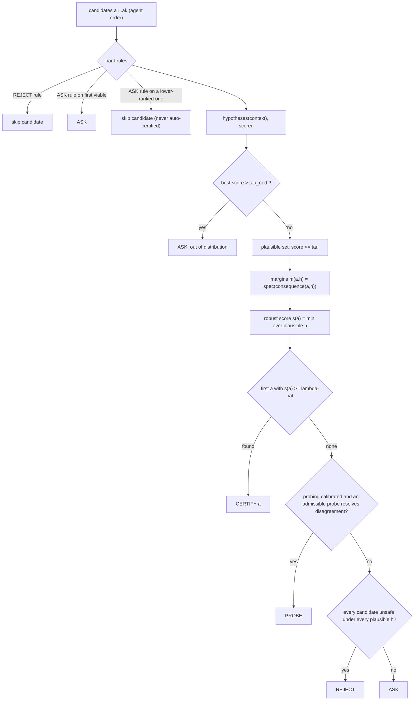

# Concepts

This page explains riskgate from first principles: first a plain-language picture, then the precise version.

## The picture (no jargon)

An AI agent wants to do something consequential: scale a service, refund a customer, change a reactor setpoint. Before it acts, riskgate asks three questions:

1. **What could be going on?** The situation is never fully known. A latency spike might be a traffic surge, a slow database query or a broken release. riskgate keeps *every explanation the evidence cannot rule out*. These are the **hypotheses**.
2. **What would this action do in each case?** A simulator, digital twin or dry-run predicts the outcome under each hypothesis. This is the **consequence model**.
3. **Is it safe in the worst plausible case, by a margin we have learned to trust?** Each predicted outcome is scored against the safety rules: positive means safe, negative means a violation. This is the **spec** and its **margin**. The action's score is its worst margin across plausible hypotheses. It is certified only if the score clears a **threshold calibrated on past incidents**, so that unsafe certifications happen at most α of the time.

If the action is not certified, riskgate does one of three things:
- tells the agent why (**REJECT**: unsafe under every explanation);
- suggests a harmless check that would settle the question (**PROBE**);
- hands the decision to a person (**ASK**).

## The four verdicts

| Verdict | When | Typical handling |
|---|---|---|
| `CERTIFY` | robust score ≥ calibrated threshold λ̂ | execute the tool |
| `REJECT` | unsafe under **every** plausible hypothesis, or blocked by a hard rule | return the binding constraint to the agent so it can re-plan |
| `PROBE` | plausible hypotheses disagree about which actions are safe, and an admissible read-only probe resolves enough of the disagreement | run the probe (e.g. read a backup sensor, query `pg_stat_statements`, ask the customer), update the context, re-check with `stage=2` |
| `ASK` | everything else: ambiguity, out-of-distribution evidence, void calibration, errors, timeouts | escalate to a human with the gate's explanation |

## The components you provide

| Component | Protocol | Examples |
|---|---|---|
| **Consequence model** | `predict(action, hypothesis, context) -> outcome` (optionally `predict_batch`) plus a `version` string | first-principles twin, queueing model, SQLite transaction plus rollback, `kubectl --dry-run`, `terraform plan`, physics simulator, learned world model |
| **Hypothesis provider** | `hypotheses(context) -> [Hypothesis(name, family, params, score)]` plus `version` | fault diagnoser, intent parser, incident classifier; scores are nonconformity scores (e.g. normalised residuals or negative log posterior) |
| **Spec** | `Spec(Upper, Lower, Envelope, Predicate, Custom, STLConstraint ...)` | SLOs, safe operating envelopes, budget limits, "no improper payout" |
| Hard rules (optional) | `HardRule(name, fires(action, ctx), verdict, message, version=None)` | approvals above $500, "verify identity first", allow-lists |
| Probes (optional) | read-only `Action`s whose predicted outcomes include an `observation` vector | sensor reads, diagnostics queries, clarifying questions |

The **agent** (the *doer*) is not a component of the gate. It proposes ranked candidates in whatever framework you use, and riskgate never trusts it.

## How a decision is made

## Calibration in one paragraph

You give the gate labelled **episodes**: past or simulated decision points, each with the candidates the agent proposed and whether each would have violated the spec. riskgate uses part of them to set the plausible-set threshold τ. On the rest it computes every episode's loss as a function of the threshold and picks the smallest λ̂ for which conformal risk control guarantees the expected unsafe-certification rate is at most α. The result is a signed, fingerprinted **calibration artefact**. Details: [Calibration & guarantees](calibration.md).

## Guarantee status

Every decision carries `status`:

| Status | Meaning | Gate behaviour |
|---|---|---|
| `VALID` | calibrated; components match the artefact's fingerprint; no drift alarm | normal |
| `DEGRADED` | the drift monitor fired: deployment no longer looks like calibration. The alarm is *latched* until you recalibrate (or call `monitor.reset()`) | the threshold becomes `max(λ̂, λ_online)` (only tighter); recalibrate soon |
| `VOID` | no calibration, or the fingerprint changed: spec (including the code of custom constraints), model version, hypothesis-provider version, probes, hard rules (including their code), score/weight functions, mode or (policy mode) doer | every check returns `ASK` until you recalibrate |

## Design rules (why you can trust the certify path)

1. **R1 independence.** No LLM is consulted when certifying. LLM-derived inputs may only add hypotheses or rules, which can only make the gate more cautious.
2. **R2 validity by calibration.** The bound comes from labelled outcomes, not from the model being right. A bad model means more `ASK`, not more harm.
3. **R3 fail closed.** Exceptions, NaNs, timeouts, an unavailable context snapshot, a failing audit sink and stale artefacts all produce `ASK`.
4. **R4 humility.** The gate tells you when its guarantee does not apply.
5. **R5** thin adapters, **R6** auditable decisions, **R7** numpy-only core.
