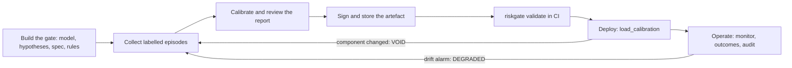

# Operations

This page covers running riskgate in production: where calibration data comes from, how to handle artefacts, what each guarantee status means and what to do about it, and how to set up monitoring, delayed outcomes, recalibration, audit, telemetry and performance settings. A [deployment checklist](#deployment-checklist) closes the page.

The snippets run top to bottom in one session, and the `# ->` comments show their real output. They use the leaky-tank toy from the [API reference](api.md#setup-used-on-this-page):

```python
import numpy as np
import riskgate as rg


class Tank:
    version = "tank-v1"

    def predict(self, action, hyp, ctx):
        return {"level": ctx["level"] + action.args.get("v", 0.0) - hyp.params["leak"]}


class LeakHyps:
    version = "leak-v1"

    def hypotheses(self, ctx):
        return [rg.Hypothesis(f"leak{l}", family=f"leak{l}", params={"leak": l},
                              score=abs(ctx["evidence"] - l) / 5) for l in (0, 10, 25)]


ACTIONS = [rg.Action("add", {"v": v}) for v in (40, 20, 0, -10)]


def episode(rng):
    leak, level = int(rng.choice([0, 10, 25])), float(rng.uniform(30, 70))
    ctx = {"level": level, "evidence": leak + rng.normal(0, 6)}
    ranked = list(ACTIONS)
    rng.shuffle(ranked)
    unsafe = {a.key: not 10 <= level + a.args["v"] - leak <= 100 for a in ranked}
    return rg.Episode(ctx, ranked, unsafe, true_family=f"leak{leak}")


rng = np.random.default_rng(0)
episodes = [episode(rng) for _ in range(400)]
spec = rg.Spec(rg.Envelope("level", lo=10, hi=100, scale=10))
```

## Lifecycle



## Calibration data sources

The guarantee holds for decision points that are **exchangeable** with the calibration episodes. Where the labels come from therefore matters as much as how many there are.

| Source | Labels available for | Usable modes | Watch out for |
|---|---|---|---|
| **High-fidelity simulator / digital twin** (randomised parameters, noise) | every candidate (counterfactual) | agnostic, policy | Sim-to-real gap: the bound holds for the simulated distribution. Never use the gate's own consequence model as the source of truth. |
| **Sandbox replay** (staging namespace, database clone, payment test mode, `kubectl --dry-run=server`, `terraform plan`) | every candidate | agnostic, policy | Replay the context *as it was at decision time*. The sandbox must be isolated from production. |
| **Staging and canary experiments** | executed actions, plus a few alternatives | policy | Small samples, and situations that are easier than production. |
| **Labelled postmortems and audited production logs** | executed actions only | policy | Selection bias (only some incidents get postmortems), uneven label quality. Unlabelled alternatives count as unsafe, which raises the ask rate. |
| **Expert review of proposals** | any candidate a reviewer labels | agnostic, policy | Cost, agreement between reviewers, and labels that must follow the spec's definition of unsafe. |

Requirements, whatever the source:

- **Same regime as deployment.** The same component versions, the same mix of situations and, in policy mode, the same doer (model, prompt, temperature: `doer_id`). Collect after the last component change.
- **Held out.** Do not use calibration episodes to fit or tune the consequence model, the hypothesis scores, the spec scales or α. Use a separate development split for that.
- **Labels follow the spec.** "Unsafe" must mean "the spec was (or would have been) violated", over the same horizon the spec evaluates.
- **Enough of them.** At least ⌈1/α⌉ risk-control episodes (enforced). Aim for 10/α or more, plus about 30% more for the τ split. Two-stage probing also needs split B to hold at least ⌈1/((1 − `probe_share`)·α)⌉ episodes ([details](api.md#gatecalibrate)).
- **A manifest.** Store the data window, the dataset hash, the doer and component versions and the label source next to the artefact. The artefact itself records only the fingerprint, the thresholds and the diagnostics.

### Safe database dry-runs

> [!WARNING]
> **A savepoint is not a sandbox.** Running the agent's statement on the live database and then rolling back has
> side effects:
>
> - **MySQL, MariaDB and Oracle commit DDL implicitly**, together with the work before it in the transaction. A
>   "dry-run" `DROP TABLE` or `ALTER TABLE` really happens.
> - **PostgreSQL** rolls DDL back. But a rolled-back mass `UPDATE` / `DELETE` still holds row locks while it runs
>   and writes WAL, which can stall other writers and replication. Sequence increments and calls through `dblink`
>   or foreign-data wrappers are not undone.
> - **`EXPLAIN ANALYZE` executes the statement.** Plain `EXPLAIN` does not.

Prefer, in order:

1. a **clone, branch or restored snapshot** of the database;
2. a **read-only rewrite** on a replica or with a read-only role, e.g. `SELECT count(*) FROM t WHERE <same predicate>`;
3. only if neither is possible, and only on PostgreSQL: a transaction with `SET LOCAL lock_timeout` and
   `SET LOCAL statement_timeout`, a role that cannot run DDL, and an unconditional `ROLLBACK`.

The refunds example (`examples/refunds_agent.py`) uses a savepoint safely only because every ticket gets its own
in-memory SQLite copy.

## Artefacts: signing and storage

Sign every artefact you deploy, and verify the signature when you load it:

```python
import os

os.environ["RISKGATE_KEY"] = "demo-key"          # in production: injected from your secret manager
gate = rg.Gate(Tank(), spec, LeakHyps(), alpha=0.1)
cal = gate.calibrate(episodes)
cal.save(f"tank.{cal.id}.cal.json", key=os.environ["RISKGATE_KEY"])

prod = rg.Gate(Tank(), spec, LeakHyps(), alpha=0.1)
prod.load_calibration(f"tank.{cal.id}.cal.json", key=os.environ["RISKGATE_KEY"], require_signature=True)
print(prod.status(), prod.calibration.id == cal.id)            # -> GuaranteeStatus.VALID True
```

- **Key management.** Keep the HMAC key in a secret manager. Grant it to the calibration pipeline (signing) and to deployments (verifying), and never write it into config files: `gate_from_config` reads it from the environment variable named by [`calibration_key_env`](configuration.md#top-level). The CLI reads `RISKGATE_KEY`. HMAC is symmetric, so anyone who can verify can also sign. It gives tamper evidence, not secrecy and not third-party provenance. If you need provenance, also sign the file with an external tool (for example Sigstore); riskgate does not do this.
- **Key rotation.** Re-sign with the new key. The artefact id does not change:

```python
rg.Calibration.load(f"tank.{cal.id}.cal.json", key="demo-key").save("tank.rotated.cal.json", key="new-key")
print(rg.Calibration.load("tank.rotated.cal.json", key="new-key", require_signature=True).id == cal.id)   # -> True
```

- **Storage.** Use immutable, versioned storage (an object store with versioning or WORM retention). Name files by artefact id, mount them read-only in production, and keep the previous artefact for rollback. Never edit an artefact by hand: the signature breaks, and an unsigned edit silently changes the guarantee.
- **Release gating.** Run `riskgate validate ARTEFACT --gate pkg.module:make_gate` in CI. It exits 3 if the build's components no longer match the artefact ([CLI](cli.md#riskgate-validate)).

## Guarantee status: what it means and what to do

Every `Decision` carries `status`, the guarantee status at the time of the check.

| Status | Cause | What the gate does | What to do |
|---|---|---|---|
| `VALID` | Calibrated, fingerprints match, no drift alarm. | Normal operation. A `CERTIFY` is covered by the calibrated bound (marginally over episodes). | Watch the dashboards and report outcomes. |
| `DEGRADED` | The drift monitor's martingale crossed `alarm_level`. The alarm is latched. | Still certifies, but only with `max(λ̂, λ_online)`: online adaptation can only tighten. **The formal bound no longer applies.** | Alert the owner. Investigate the shift (traffic mix, model drift, doer change, sensor faults). Decide whether to keep running tightened, route every action to a human, or roll back. Collect fresh labelled episodes from the new regime and [recalibrate](#recalibration-workflow). Call `monitor.reset()` only after a documented decision that the alarm was spurious. |
| `VOID` | No artefact loaded, or a component changed since calibration (fingerprint mismatch). | Every check returns `ASK`. With `require_calibration=False` the gate still evaluates and may `REJECT`, but never `CERTIFY` or `PROBE` (the would-be verdict is kept in `would_verdict`). | Expected right after deploying a changed component. Recalibrate with episodes produced by the new components, or roll the component back. `riskgate validate` in CI keeps VOID builds out of production. |

A stricter execution policy runs certified actions autonomously only while the status is `VALID`:

```python
def act(gate, proposals, context, execute, escalate):
    d = gate.check_ranked(proposals, context)
    if d.verdict is rg.Verdict.CERTIFY and d.status is rg.GuaranteeStatus.VALID:
        return execute(d.action)
    return escalate(d)          # ASK / REJECT / PROBE, or a certification under DEGRADED


print(act(prod, [rg.Action("add", {"v": 20})], {"level": 50, "evidence": 1.0},
          execute=lambda a: f"executed {a.key}", escalate=lambda d: f"escalated: {d.verdict.value}"))   # -> executed add({"v":20})
```

## Monitoring: drift alarm and tighten-only threshold

**What is tested.** For every stage-1 decision, the [`Monitor`](api.md#monitor) takes `Decision.top_score`, the best robust score among the viable candidates. It compares that score with the calibration reference (the best score of each risk-control episode) through a randomised conformal p-value. A small p means the margins are unusually *low*: situations look more dangerous, or the models more uncertain, than during calibration. A mixture of power martingales accumulates the evidence.

Hard-rule exits and out-of-distribution contexts count as score −∞, as they do in calibration, so a surge of blocked or OOD requests also raises the alarm. Stage-2 (post-probe) decisions are not fed to the monitor, and neither are checks made while the status is `VOID`.

**Choosing `alarm_level`.** By Ville's inequality, under exchangeability the probability that the martingale *ever* reaches *c* is at most 1/*c*. The bound is approximate, because the reference is a fixed finite sample.

| `alarm_level` | False-alarm probability (whole deployment) | Use when |
|---|---|---|
| 20 | ≤ 5% | Alarms are cheap (they open a ticket) and you want early detection. |
| 100 (default) | ≤ 1% | General purpose. |
| 1000 | ≤ 0.1% | Alarms are expensive (paging, forced recalibration). |

A larger *c* delays detection only logarithmically: under a strong shift, tens of decisions suffice. Before you rely on the alarm, replay held-out in-distribution episodes through the gate and check that the martingale stays small.

**Latching.** By default (`Monitor(latch=True)`) the alarm stays on, and the status stays `DEGRADED`, until the gate is recalibrated or loads an artefact (`bind`), or someone calls `monitor.reset()`.

**Tighten-only online threshold.** While the status is `DEGRADED`, the gate uses `max(λ, monitor.online_lambda)`. Each reported outcome of a certified action updates `online_lambda += eta * (1{unsafe} − alpha)`. With the default η (5% of the 10–90% spread of the calibration scores), every unsafe outcome raises the threshold by η(1 − α), and every safe one lowers it by ηα. It never drops below the calibrated λ.

```python
mon = rg.Monitor(alarm_level=20)
g = rg.Gate(Tank(), spec, LeakHyps(), alpha=0.1, monitor=mon)
g.calibrate(episodes)
ctx, risky = {"level": 50, "evidence": 1.0}, rg.Action("add", {"v": 45})
d = g.check(risky, ctx)
print(g.status(), d.verdict, f"score={d.score:.2f} threshold={d.threshold:.3f}")          # -> GuaranteeStatus.VALID Verdict.CERTIFY score=0.50 threshold=-1.499
for _ in range(40):                                  # the world shifts: proposals look far more dangerous
    g.check(rg.Action("add", {"v": 40}), {"level": 75, "evidence": 25.0})
print(g.status(), f"martingale={mon.martingale:.3g}")                                       # -> GuaranteeStatus.DEGRADED martingale=1.58e+21
for _ in range(40):                                  # certified actions keep turning out unsafe
    g.record_outcome(g.check(rg.Action("add", {"v": 0}), ctx), unsafe=True)
d = g.check(risky, ctx)
print(d.verdict, f"threshold={d.threshold:.3f} online={mon.online_lambda:.3f} observed risk={mon.observed_risk}")  # -> Verdict.ASK threshold=0.587 online=0.587 observed risk=1.0
```

Export `monitor.martingale` (or `log_martingale`), `monitor.alarm`, `monitor.online_lambda` and `monitor.observed_risk` as gauges ([OpenTelemetry](#opentelemetry)). Alert on `status != valid`.

## Delayed outcomes

Labels often arrive later than decisions: the SLO window closes after 30 minutes, a chargeback resolves after weeks. The gate registers every `CERTIFY` made while the status is not `VOID` under its `decision_id`, as long as a monitor is attached:

```python
d = g.check(rg.Action("add", {"v": 20}), ctx)        # persist d.decision_id with your execution record
job = {"decision_id": d.decision_id, "action": d.action.key}
# ... minutes or days later, when the outcome is known:
print(g.record_outcome(job["decision_id"], unsafe=False), g.record_outcome(job["decision_id"], unsafe=False))  # -> True False
```

- `record_outcome` returns `True` once per registered decision. It returns `False` for unknown ids, duplicates, decisions certified under a previous artefact (the pending set is cleared at every `bind`), and when no monitor is attached.
- Pending decisions live in memory: at most 100,000, oldest evicted, lost on restart. For offline analysis, join the audit log's `decision_id`s with your outcome store, and compute the realised risk per `calibration_id`.
- `monitor.observed_risk` is the unsafe share of reported outcomes since the last `bind`. Compare it with α using a confidence interval: a handful of outcomes says little.
- Outcomes must use the same definition and horizon as the calibration labels.

## Recalibration workflow

Recalibrate when:

- the drift alarm fires;
- a component changes: a new model or provider version, a spec or rule edit, a new doer in policy mode (all of these make the artefact `VOID`);
- the definition of the labels changes;
- on a schedule, to keep the reference sample current.

1. **Freeze the components.** Bump the `version` strings and set `doer_id`.
2. **Collect fresh labelled episodes from the current regime**, produced by the components that will be deployed. Do not re-run calibration on the same data while tweaking settings until λ looks good: that is selection, and it voids the guarantee. Tune on a development split.
3. **Calibrate**: `gate.recalibrate(episodes)`, or `calibrate` followed by `load_calibration`. Then review `riskgate report`: ask rate, calibration risk, `evaluation_failures` (should be 0), probing.
4. **Sign and store** under the new id. Keep the old artefact for rollback.
5. **Validate and deploy.** `riskgate validate` against the release build, then `load_calibration(path, key=..., require_signature=True)`. Loading resets the monitor.
6. **Watch.** The martingale should return to around 1 and the ask rate to its calibrated level. Keep reporting outcomes.

```python
fresh = [episode(rng) for _ in range(400)]           # new labelled episodes from the current regime
cal2 = g.recalibrate(fresh)                          # new artefact; the monitor is re-bound (alarm cleared)
cal2.save(f"tank.{cal2.id}.cal.json", key=os.environ["RISKGATE_KEY"])
print(g.status(), cal2.id != cal.id, mon.observed_risk, f"martingale={mon.martingale:.0f}")   # -> GuaranteeStatus.VALID True None martingale=1
```

## Audit logs and redaction

[`AuditLog`](api.md#auditlog) writes one JSON line per decision: `ts`, your static `extra` fields, then `Decision.to_dict()`:

- `verdict`, `action`, `score`, `top_score`, `threshold`;
- per-hypothesis `margins` and `binding` constraints, and the `plausible` set;
- `probe`, `reason`, `status`, `calibration_id`;
- `considered`, `stage`, `latency_ms`, `decision_id`.

The **context is never logged**. **Action arguments are**, so redact sensitive ones:

- in Python, `AuditLog(path, redact=fn)` applies `fn(record) -> record` before writing, so it can drop, hash or truncate fields;
- in configuration, `[audit] redact = ["action.args.customer_email"]` replaces those dotted paths with `"[redacted]"`.

The gate calls `audit.write(decision)` without per-request fields. Put static fields in `extra`. For per-request fields (incident id, end user), wrap the log in a small sink that reads them from a `contextvars.ContextVar` set by your agent loop:

```python
import contextvars
import hashlib
import json

request_fields = contextvars.ContextVar("request_fields", default={})


class RequestAudit:
    """Adds the current request's fields to every record written by the wrapped sink."""

    def __init__(self, sink):
        self.sink = sink

    def write(self, decision, **fields):
        self.sink.write(decision, **request_fields.get(), **fields)


def redact(rec):                                      # hash tool arguments, drop per-hypothesis margins
    if rec.get("action"):
        h = hashlib.sha256(json.dumps(rec["action"]["args"], sort_keys=True).encode()).hexdigest()[:12]
        rec["action"] = dict(rec["action"], args=f"sha256:{h}")
    return dict(rec, margins=None)


g.audit = RequestAudit(rg.AuditLog("logs/decisions.jsonl", extra={"service": "tank-1"}, redact=redact))
request_fields.set({"incident_id": "INC-000042"})
g.check(rg.Action("add", {"v": 20}), ctx)
rec = json.loads(open("logs/decisions.jsonl").readline())
print(rec["service"], rec["incident_id"], rec["action"]["args"], rec["margins"], rec["verdict"])   # -> tank-1 INC-000042 sha256:fea504fd7c1d None certify
```

- **Fail closed.** If the audit sink raises, a `CERTIFY` becomes `ASK` (`fail-closed: audit sink error ...`): an unrecorded decision never runs autonomously. [`MultiSink`](api.md#multisink) swallows errors from its members, so do not put the authoritative log inside one (see the recipe below).
- **Storage.** Ship the file to append-only storage (WORM bucket, SIEM). Set retention and access control: records contain reasons and (redacted) arguments.
- **Parsing.** Decisions that stop before scoring have `score: NaN`, and infinite values appear as `Infinity` or `-Infinity`. These are Python's JSON extensions: read the file with Python's `json`, pandas, or another tolerant parser.
- **Summaries.** `riskgate audit-summary decisions.jsonl` or `rg.summarize_audit(path)` give verdict and status counts and latency percentiles ([CLI](cli.md#riskgate-audit-summary)).

## OpenTelemetry

`riskgate.telemetry.OTelSink` is an audit sink (`pip install "riskgate[otel]"` plus an exporter) that emits:

| Signal | Name | Attributes |
|---|---|---|
| span (one per decision) | `riskgate.check` | `riskgate.verdict`, `.status`, `.action`, `.stage`, `.calibration_id`, `.decision_id`, `.probe`; `.score` and `.threshold` when finite; `riskgate.extra.<field>` for extra fields |
| counter | `riskgate.decisions` | `verdict`, `status` |
| histogram | `riskgate.latency_ms` | unit `ms` |
| histogram | `riskgate.margin` | non-negative robust margin of the decided action, attribute `verdict` |
| histogram | `riskgate.margin_deficit` | −margin for negative robust margins, attribute `verdict` |

OpenTelemetry histograms accept only non-negative values, so margins are split. Each decision with a finite score contributes to exactly one of `riskgate.margin` and `riskgate.margin_deficit`.

The martingale and the online threshold are not exported by riskgate. Register observable gauges for them yourself. The recipe below keeps the audit log authoritative (its failures fail closed) while telemetry stays best effort:

```python
from opentelemetry.metrics import Observation
from opentelemetry.sdk.metrics import MeterProvider
from opentelemetry.sdk.metrics.export import InMemoryMetricReader
from opentelemetry.sdk.trace import TracerProvider
from opentelemetry.sdk.trace.export import SimpleSpanProcessor
from opentelemetry.sdk.trace.export.in_memory_span_exporter import InMemorySpanExporter
from riskgate.telemetry import OTelSink


class AuditThenTelemetry:
    """Authoritative audit first (errors propagate, so the gate fails closed), then best-effort telemetry."""

    def __init__(self, audit, *telemetry):
        self.audit, self.telemetry = audit, rg.MultiSink(*telemetry)

    def write(self, decision, **fields):
        self.audit.write(decision, **fields)
        self.telemetry.write(decision, **fields)


reader, spans = InMemoryMetricReader(), InMemorySpanExporter()        # in production: OTLP exporters
meter = MeterProvider(metric_readers=[reader]).get_meter("riskgate")
tracer_provider = TracerProvider()
tracer_provider.add_span_processor(SimpleSpanProcessor(spans))
meter.create_observable_gauge("riskgate.martingale", callbacks=[lambda opts: [Observation(mon.martingale)]])
meter.create_observable_gauge("riskgate.degraded", callbacks=[lambda opts: [Observation(int(mon.alarm))]])

g.audit = AuditThenTelemetry(rg.AuditLog("logs/decisions.jsonl"), OTelSink(tracer=tracer_provider.get_tracer("riskgate"), meter=meter))
for v in (0, 20, 80):
    g.check(rg.Action("add", {"v": v}), ctx)
names = sorted(m.name for rm in reader.get_metrics_data().resource_metrics for sm in rm.scope_metrics for m in sm.metrics)
print(names, len(spans.get_finished_spans()))                                                   # -> ['riskgate.decisions', 'riskgate.degraded', 'riskgate.latency_ms', 'riskgate.margin', 'riskgate.margin_deficit',
#     'riskgate.martingale'] 3
```

Useful dashboards and alerts:

- **Rates.** Ask rate and reject rate (`riskgate.decisions` by `verdict`), compared with the calibration ask rate in `riskgate report`.
- **Status.** Any `status` other than `valid` (`riskgate.decisions` by `status`, or the `riskgate.degraded` gauge).
- **Latency.** p95 of `riskgate.latency_ms`, against your `timeout_s`.
- **Drift.** Shifts in the `riskgate.margin` and `riskgate.margin_deficit` distributions, and the `riskgate.martingale` gauge against `alarm_level`.
- **Outcomes.** `monitor.observed_risk` against α.

## Timeouts, caching and parallelism

| Setting | Behaviour | Advice |
|---|---|---|
| `timeout_s` | Each check runs in a worker thread and must finish within `timeout_s`. If not, the gate returns `ASK` (`timeout: no decision within ...s`). The worker is **not** cancelled and keeps running in the background, in a pool of `max(2, parallel)` threads. | Bound the model's own calls (HTTP and DB timeouts). Repeated timeouts can fill the pool, so later checks also time out: the gate fails closed, but every check then returns `ASK`. Size the timeout from the p99 latency. `calibrate()` does not use it. |
| `cache_size` + `context_key` | LRU cache of margin matrices keyed by `(context_key(context), action keys, hypothesis names)`. It also serves calibration. | The key must change whenever anything the model reads changes, for example a snapshot id plus a revision number. Use keys that are unique per episode during calibration. A cache helps when the same situation is checked repeatedly (retries, frameworks that re-run a call after human confirmation). |
| `parallel` | Thread pool that evaluates (action, hypothesis) pairs for models **without** `predict_batch`. | Good for I/O-bound dry-runs (`predict` must be thread-safe). For CPU-bound Python models, implement a vectorised `predict_batch` instead. |

```python
import time


class SlowTank(Tank):
    def predict(self, action, hyp, ctx):
        time.sleep(0.2)                                  # a dry-run that hangs
        return super().predict(action, hyp, ctx)


slow = rg.Gate(SlowTank(), spec, LeakHyps(), alpha=0.1, timeout_s=0.05)
slow.load_calibration(cal)                               # same fingerprint: SlowTank inherits version "tank-v1"
d = slow.check(rg.Action("add", {"v": 20}), ctx)
print(d.verdict, "|", d.reason)                          # -> Verdict.ASK | timeout: no decision within 0.05s
```

The gate's own overhead is small: about 0.3 ms per check in the toy example ([CLI audit summary](cli.md#riskgate-audit-summary)). The consequence model dominates latency. `Decision.latency_ms` measures the whole check.

**Concurrency.** `AuditLog` writes and the margin cache are protected by locks. The `Monitor` is updated without a lock. If many threads share one gate, either serialise the checks, or accept that monitor updates from concurrent checks may interleave. One gate per worker process is the simplest setup.

## Deployment checklist

- [ ] Component identity: `version` strings are bumped on every model or hypothesis-provider change, and `doer_id` is set in policy mode.
- [ ] Calibration data: from the deployment regime, labelled per the spec, held out from any tuning, at least 10/α risk-control episodes plus the τ split. The manifest is stored.
- [ ] `riskgate report` reviewed: acceptable calibration ask rate, `evaluation_failures` = 0, probing as intended.
- [ ] Artefact signed. Key in a secret manager. Immutable storage. `require_signature=True` at load (or `require_signature = true` in config).
- [ ] `riskgate validate` passes in CI for the release build (exit 0, never 3).
- [ ] `require_calibration=True` (the default) in production.
- [ ] Fail-closed paths tested: model exceptions, `timeout_s`, context failures and audit failures all lead to `ASK`, and the human escalation path (`on_ask`, `ApprovalRequired`, framework HITL) works end to end.
- [ ] Hard rules cover catastrophic or irreversible actions (`REJECT`) and approval requirements (`ASK`).
- [ ] Monitor attached, `alarm_level` chosen, alerts on `DEGRADED` and `VOID`, and a runbook for each status.
- [ ] Outcomes wired: `decision_id` persisted, and `record_outcome` called when labels arrive.
- [ ] Audit log in append-only storage, redaction reviewed, retention set. Telemetry is best effort.
- [ ] Dry-runs isolated from production (clones, branches or snapshots, staging namespaces; no savepoints on the live database: see [Safe database dry-runs](#safe-database-dry-runs)).
- [ ] Recalibration plan: owner, data source, cadence, rollback artefact.
- [ ] Everyone knows what is **not** guaranteed: per-situation (conditional) risk, validity under shift, multi-step closed-loop behaviour, and wrong labels ([Calibration & guarantees](calibration.md)).
