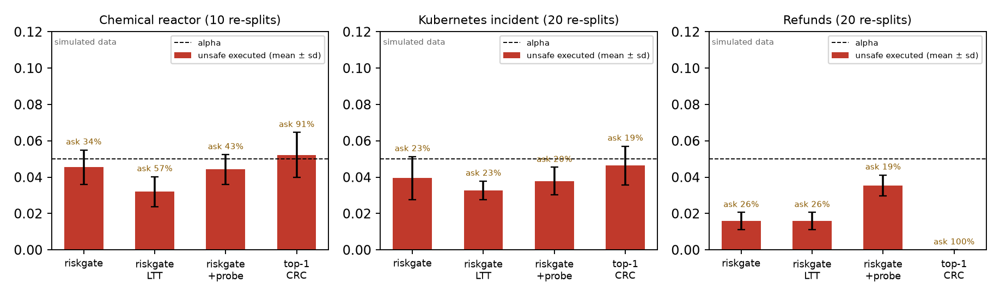
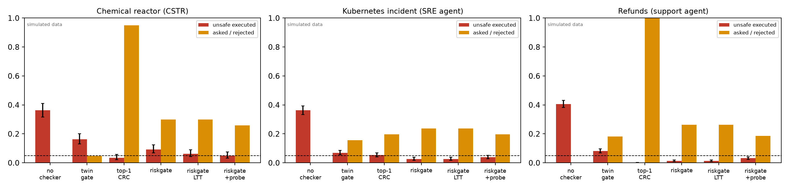
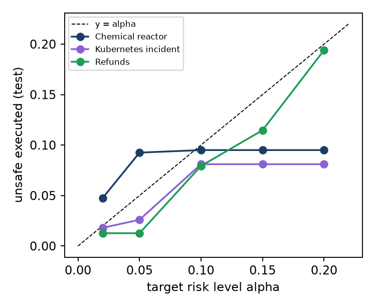

# Results (simulated domains)

> [!IMPORTANT]
> Everything on this page comes from **simulated** domains with **scripted** (LLM-like) agents. The simulators use realistic parameters, the truth simulator always differs from the gate's model, and labels are counterfactual outcomes for every candidate. Real-LLM evaluations are planned. This page is generated by [`examples/report.py`](https://github.com/reallysaurabh/riskgate/blob/main/examples/report.py) from `examples/results/*.json`.

## Setup

| | Chemical reactor (CSTR) | Kubernetes incident | Refunds |
|---|---|---|---|
| consequence model | first-principles twin, unaware of plant mismatch | Erlang-C queueing twin, Postgres limits | SQLite transactional dry-run |
| latent state (hypotheses) | fault type × magnitude (19) | incident cause × magnitude (13) | order/item intent × unsynced chargeback |
| spec | 340 K ≤ T ≤ 362 K for 30 min | p95 ≤ 800 ms and errors ≤ 2% each minute | no improper payout |
| calibration / test / shift episodes | 800 / 400 / 200 | 1500 / 1000 / 600 | 4000 / 1500 / 600 |

All methods see identical episodes and identical agent proposals. α = 5%, δ = 5%, policy mode; 30% of the calibration episodes set the plausible-set threshold τ, the rest the acceptance threshold(s).

| Method | What it does |
|---|---|
| No checker | execute the agent's first choice |
| Twin gate | certify if the margin under the single best-fitting hypothesis is ≥ 0 (today's twin-gated agents) |
| Top-1 + CRC | the same score, with a threshold calibrated by conformal risk control |
| riskgate | worst margin over all plausible hypotheses, CRC threshold (expectation guarantee) |
| riskgate (LTT) | the same score with the high-probability guarantee, P(risk ≤ α) ≥ 0.9 |
| riskgate + probe | two-stage probing (λ₁ at 0.6α, λ₂ at 0.4α over all episodes of its split) |

## 1. Validity: mean over random re-splits

Conformal risk control bounds the risk **in expectation over calibration sets**. The right check is therefore the mean test unsafe rate over random re-splits of the pooled calibration and test episodes.

| Domain | Method | re-splits | unsafe (mean ± sd) | ask (mean) | splits above α |
|---|---|---|---|---|---|
| Chemical reactor (CSTR) | riskgate | 10 | 4.6% ± 0.9% | 33.6% | 20.0% |
| Chemical reactor (CSTR) | riskgate (LTT) | 10 | 3.2% ± 0.8% | 57.5% | 0.0% |
| Chemical reactor (CSTR) | riskgate + probe | 10 | 4.4% ± 0.8% | 42.5% | 20.0% |
| Chemical reactor (CSTR) | Top-1 + CRC | 10 | 5.2% ± 1.2% | 90.7% | 40.0% |
| Kubernetes incident (SRE agent) | riskgate | 20 | 4.0% ± 1.2% | 22.7% | 15.0% |
| Kubernetes incident (SRE agent) | riskgate (LTT) | 20 | 3.3% ± 0.5% | 23.0% | 0.0% |
| Kubernetes incident (SRE agent) | riskgate + probe | 20 | 3.8% ± 0.8% | 20.4% | 10.0% |
| Kubernetes incident (SRE agent) | Top-1 + CRC | 20 | 4.6% ± 1.1% | 19.3% | 30.0% |
| Refunds (support agent) | riskgate | 20 | 1.6% ± 0.5% | 25.7% | 0.0% |
| Refunds (support agent) | riskgate (LTT) | 20 | 1.6% ± 0.5% | 25.7% | 0.0% |
| Refunds (support agent) | riskgate + probe | 20 | 3.5% ± 0.6% | 18.9% | 0.0% |
| Refunds (support agent) | Top-1 + CRC | 20 | 0.0% ± 0.0% | 100.0% | 0.0% |




"Splits above α" includes test-sampling noise (a few hundred test episodes per split), so it is not expected to be zero even for a valid method.

## 2. One fixed split (nominal and shifted test episodes)

Brackets: 95% Wilson intervals (test sampling only). *Ask* includes rejects. Under shift the guarantee does not apply.

### Chemical reactor (CSTR)

| Method | unsafe (nominal) | ask | safe execution | probe | unsafe (shift) | ask (shift) |
|---|---|---|---|---|---|---|
| No checker | 36.2% [31.7, 41.1] | 0.0% | 63.7% | 0.0% | 32.0% | 0.0% |
| Twin gate (binary, top-1) | 16.2% [13.0, 20.2] | 4.8% | 79.0% | 0.0% | 18.5% | 14.0% |
| Top-1 + CRC | 3.5% [2.1, 5.8] | 95.0% | 1.5% | 0.0% | 2.5% | 96.5% |
| **riskgate** | 9.2% [6.8, 12.5] | 30.0% | 60.8% | 0.0% | 10.0% | 43.5% |
| **riskgate (LTT, δ′ = 0.1)** | 6.2% [4.3, 9.1] | 30.0% | 63.7% | 0.0% | 9.0% | 43.5% |
| **riskgate + probe** | 5.0% [3.3, 7.6] | 25.8% | 70.2% | 79.8% | 9.5% | 46.0% |

Calibrated: τ = 3.38, mean plausible hypotheses = 10.30, λ̂ = -5.04, λ̂ (LTT) = -5.03, λ̂ (top-1) = 10, probing λ₁/λ₂ = 7.24 / 9.18 (227 probed calibration episodes).

### Kubernetes incident (SRE agent)

| Method | unsafe (nominal) | ask | safe execution | probe | unsafe (shift) | ask (shift) |
|---|---|---|---|---|---|---|
| No checker | 36.2% [33.3, 39.2] | 0.0% | 63.8% | 0.0% | 35.5% | 0.0% |
| Twin gate (binary, top-1) | 6.9% [5.5, 8.6] | 15.7% | 77.4% | 0.0% | 8.3% | 14.5% |
| Top-1 + CRC | 5.3% [4.1, 6.9] | 19.6% | 75.1% | 0.0% | 5.2% | 19.5% |
| **riskgate** | 2.6% [1.8, 3.8] | 23.8% | 73.6% | 0.0% | 5.0% | 23.0% |
| **riskgate (LTT, δ′ = 0.1)** | 2.6% [1.8, 3.8] | 23.8% | 73.6% | 0.0% | 5.0% | 23.0% |
| **riskgate + probe** | 3.8% [2.8, 5.2] | 19.7% | 76.5% | 14.4% | 6.5% | 19.0% |

Calibrated: τ = 4.57, mean plausible hypotheses = 3.84, λ̂ = -1.41, λ̂ (LTT) = -1.41, λ̂ (top-1) = 0.635, probing λ₁/λ₂ = 0.349 / -4.98 (69 probed calibration episodes).

### Refunds (support agent)

| Method | unsafe (nominal) | ask | safe execution | probe | unsafe (shift) | ask (shift) |
|---|---|---|---|---|---|---|
| No checker | 40.6% [38.1, 43.1] | 0.0% | 59.4% | 0.0% | 46.0% | 0.0% |
| Twin gate (binary, top-1) | 8.1% [6.8, 9.6] | 18.1% | 73.9% | 0.0% | 11.3% | 19.2% |
| Top-1 + CRC | 0.0% [0.0, 0.3] | 100.0% | 0.0% | 0.0% | 0.0% | 100.0% |
| **riskgate** | 1.3% [0.8, 2.0] | 26.3% | 72.4% | 0.0% | 4.2% | 28.5% |
| **riskgate (LTT, δ′ = 0.1)** | 1.3% [0.8, 2.0] | 26.3% | 72.4% | 0.0% | 4.2% | 28.5% |
| **riskgate + probe** | 3.1% [2.4, 4.1] | 18.7% | 78.2% | 8.9% | 7.0% | 19.0% |

Calibrated: τ = 1.47, mean plausible hypotheses = 1.25, λ̂ = 1, λ̂ (LTT) = 1, λ̂ (top-1) = ∞, probing λ₁/λ₂ = 1 / -0.65 (106 probed calibration episodes).



## 3. Target levels (riskgate, fixed split)

| Domain | α = 0.02 | α = 0.05 | α = 0.10 | α = 0.15 | α = 0.20 |
|---|---|---|---|---|---|
| Chemical reactor (CSTR): unsafe | 4.8% | 9.2% | 9.5% | 9.5% | 9.5% |
| ask | 30.0% | 30.0% | 30.0% | 30.0% | 30.0% |
| Kubernetes incident (SRE agent): unsafe | 1.8% | 2.6% | 8.1% | 8.1% | 8.1% |
| ask | 26.0% | 23.8% | 21.4% | 21.4% | 21.4% |
| Refunds (support agent): unsafe | 1.3% | 1.3% | 7.9% | 11.5% | 19.4% |
| ask | 26.3% | 26.3% | 23.1% | 21.2% | 16.3% |



## 4. What the numbers say

1. **The agent alone is often wrong.** Its first choice is unsafe in 36.2% (reactor), 36.2% (Kubernetes), 40.6% (refunds) of test episodes. A binary twin gate removes most of that but still lets through 16.2%, 6.9%, 8.1%.
2. **riskgate meets the target on average** in all three domains (table 1), and so do its high-probability and probing variants. The high-probability variant also *narrows* the spread of the realised risk: in the Kubernetes domain its re-split sd is 0.5% vs 1.2% at the same ask rate (23.0% vs 22.7%), and no split exceeded α in any domain; in the reactor it pays for this with many more asks (57.5% vs 33.6%). Top-1 + CRC averages 5.2% in the reactor, within re-split noise of α, while asking about almost everything.
3. **One split of the reactor lands above α** (9.2% on the fixed split). This is the variability an expectation guarantee allows, amplified by a *cliff*: one action, lowering the setpoint by 5 K (usually the agent's second choice), has a robust score of about −5.03 in many episodes, always set by the same worst-case hypothesis (a thermocouple reading 10 K high), and it is unsafe in about half of them. Whether the calibrated threshold lands just below or just above −5.03 depends on a handful of calibration episodes. The high-probability guarantee (6.2% on this split) and probing (5.0%) reduce the problem. If you need the bound for *your* artefact, use `guarantee="high_probability"`.
4. **Calibrating around the single best diagnosis is vacuous when misdiagnoses matter**: top-1 + CRC asks in 100.0% of refund and 95.0% of reactor episodes (the certification-rate ceiling, Proposition 1 of the paper). In the Kubernetes domain, where a wrong diagnosis rarely changes which actions are safe, it is competitive (5.3% unsafe, 19.6% asks vs riskgate's 2.6% and 23.8%). We report this honestly: the robust score matters most where diagnosis is ambiguous in a safety-relevant way.
5. **Probing turns some "I can't tell" into safe action**: asks fall from 26.3% to 18.7% (refunds), 23.8% to 19.7% (Kubernetes) and 30.0% to 25.8% (reactor), using risk budget that single-stage gating left unused.
6. **Under shift** riskgate degrades but stays well below the twin gate: 10.0% vs 18.5% (reactor, including an unseen fault type), 5.0% vs 8.3% (Kubernetes), 4.2% vs 11.3% (refunds), mostly by asking more.

## 5. Ablations (refunds and Kubernetes, fixed split)

| Variant | Refunds: unsafe | ask | Kubernetes incident: unsafe | ask |
|---|---|---|---|---|
| policy mode (default) | 1.3% | 26.3% | 2.6% | 23.8% |
| agnostic mode | 1.3% | 26.3% | 1.7% | 26.5% |
| policy mode, doer swapped after calibration | 1.1% | 25.1% | 5.0% | 23.8% |
| agnostic mode, doer swapped | 1.1% | 25.1% | 2.6% | 26.5% |
| δ = 0.01 | 0.1% | 48.9% | 3.1% | 34.0% |
| δ = 0.2 | 3.3% | 28.5% | 4.9% | 29.1% |
| δ = 0.5 | 4.6% | 57.7% | 4.9% | 51.1% |
| high-probability (LTT) | 1.3% | 26.3% | 2.6% | 23.8% |
| probing, ρ = 0.4 | 4.7% | 17.8% | 3.6% | 21.7% |
| probing, ρ = 0.6 | 3.1% | 18.7% | 3.8% | 19.7% |
| probing, ρ = 0.8 | 1.9% | 19.7% | 3.6% | 19.9% |
| n_cal = 150 (10 re-splits, mean ± sd) | 2.7% ± 3.0% | 29.6% | 4.0% ± 2.3% | 24.1% |
| n_cal = 300 (10 re-splits, mean ± sd) | 1.0% ± 0.9% | 28.7% | 4.3% ± 2.0% | 23.6% |
| n_cal = 600 (10 re-splits, mean ± sd) | 1.4% ± 0.6% | 26.1% | 3.9% ± 1.1% | 22.5% |
| n_cal = 1200 (10 re-splits, mean ± sd) | 1.8% ± 0.8% | 25.0% | 3.5% ± 0.7% | 22.7% |

- **Doer swap.** Re-ordering the Kubernetes agent's proposals at random after calibration raises the policy-mode risk from 2.6% to 5.0% (the edge of α); agnostic mode goes from 1.7% to 2.6%. This is why `doer_id` is part of the policy-mode fingerprint.
- **δ** trades plausible-set size against emptiness: asks are lowest around δ = 0.05.
- **Calibration size** leaves the mean below α but shrinks the spread across re-splits.
- **High-probability vs expectation** pick the same threshold on this split in both domains: their risk curves jump from well below to well above α between neighbouring thresholds. Across re-splits the high-probability threshold is stricter in some splits (table 1).
- **Probe share ρ** trades risk for fewer asks in the refund domain (a smaller ρ leaves more budget for the post-probe stage); in the Kubernetes domain the effect is small.

**Latency.** Gate overhead with a trivial model: 0.10 ms median, 0.17 ms p95. Per check with the domain models: 0.8 ms (refunds), 9.8 ms (Kubernetes) (median). The reactor twin takes about 0.1 s per uncached check.

## 6. Caveats

- Simulated domains and scripted agents; real-LLM agents and a public benchmark domain are future work.
- The guarantee is marginal (over episodes) and, by default, in expectation over calibration sets.
- Validity requires exchangeability; the end-to-end tutorial shows a drift that the input-based monitor detected only after 227 decisions, during which the unsafe rate exceeded α.
- Labels are counterfactual (available for every candidate) because the domains are simulated.

## Reproduce

```bash
cd examples
PYTHONPATH=.. python run_examples.py       # all domains (the reactor takes ~20 min)
PYTHONPATH=.. python ablations.py
python report.py                          # regenerates this page
```
